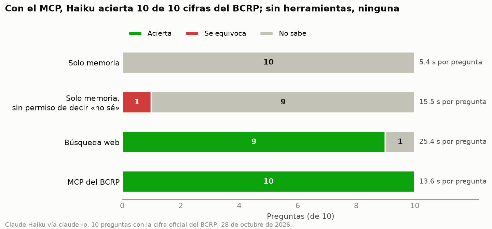

# Informe · ¿Le sirve a Claude un MCP del BCRP?

Sesión 04 · Data Science con Python · Nicolás Silva Andújar (@nicosil02) · 28 de octubre de 2026

Les hice a Claude Haiku (`claude -p`) 10 preguntas sobre cifras oficiales del BCRP en cuatro condiciones: solo con lo
que sabe de memoria, lo mismo pero sin permiso para decir «no sé», con búsqueda web y con mi servidor MCP. Cada
respuesta se compara con la cifra oficial dentro de una tolerancia de redondeo (`preguntas.csv`).



## Resultados

| Modo | Acierta | Se equivoca | No sabe | Segundos por pregunta | Archivo |
|---|---|---|---|---|---|
| Solo memoria | 0 | 0 | 10 | 5.4 | `resultados.csv` |
| Solo memoria, sin permiso de decir «no sé» | 0 | 1 | 9 | 15.5 | `resultados_sin_salida.csv` |
| Búsqueda web | 9 | 0 | 1 | 25.4 | `resultados_web.csv` |
| MCP del BCRP | **10** | 0 | 0 | 13.6 | `resultados.csv` |

## Qué acertó y qué falló cada modo, y por qué

1. **Solo memoria: 0 de 10, todas «no sé».** Todas las preguntas son de 2025 y 2026, después de lo que Haiku aprendió.
   Como la instrucción le permitía responder `null`, lo reconoció en las 10.
2. **Sin permiso para decir «no sé» (experimento extra): una cifra inventada.** Quité de `INSTRUCCION` la frase
   «Si no puedes saberlo con certeza, pon valor null: no estimes» (`uv run evaluar.py --sin-salida`). Haiku siguió
   absteniéndose en 9 de 10, pero en `ipc_mar25` respondió **0.19 %** cuando la cifra oficial es **0.81 %**. Lo
   atribuyó al INEI y reconoció en la misma respuesta que era «de memoria y no verificada». Un número sin fuente
   verificable es justo el riesgo: parece una respuesta pero está equivocado por cuatro veces.
3. **Búsqueda web: 9 de 10.** Igual que en la clase, falló el **cobre de agosto de 2026**. Las páginas que leyó de
   estadisticas.bcrp.gob.pe venían truncadas y solo encontró notas de prensa chilenas con promedios parciales del mes,
   así que respondió que no sabía. Además, varias cifras las tomó del INEI o de notas de estudio y no de la serie, y
   cada pregunta tardó 25 s: casi el doble que con el MCP y cinco veces más que solo memoria.
4. **MCP del BCRP: 10 de 10.** En cada caso Claude llamó primero a `buscar_series` y después a `serie` o `resumen`
   (4 a 6 turnos). Cada respuesta cita el código de la serie y trae la URL de la API, así que se puede repetir. Un
   detalle interesante es el oro: Claude eligió la serie diaria `PD04704XD` y pidió el `promedio` de setiembre a
   `resumen`; la cuenta la hizo Python, no el modelo, y coincidió con la serie mensual oficial.

## Dos cifras de mi MCP comprobadas a mano en la web del BCRP

| Pregunta | Mi MCP | Web del BCRP | Tabla donde lo vi |
|---|---|---|---|
| Oro LME, promedio de setiembre de 2026 (US$ por onza troy) | 4,319.21 | 4,319 | [PN01654XM](https://estadisticas.bcrp.gob.pe/estadisticas/series/mensuales/resultados/PN01654XM/html/2026-1/2026-10/) |
| Desempleo en Lima Metropolitana, jul–set 2026 (%) | 4.37 | 4.4 | [PN38063GM](https://estadisticas.bcrp.gob.pe/estadisticas/series/mensuales/resultados/PN38063GM/html/2026-1/2026-10/) |

Las dos coinciden dentro del redondeo de la web, que muestra el oro sin decimales y el desempleo con uno. Estas dos
son también mis preguntas propias en `preguntas.csv`, y su `verdad` la tomé de esas tablas, no de mi servidor.

## Mi herramienta propia: `comparar_paises`

El BCRP solo tiene datos del Perú. `comparar_paises` consulta la API del Banco Mundial (sin clave) para comparar al Perú
con otros países en seis indicadores anuales: crecimiento del PBI, inflación, desempleo, PBI per cápita, exportaciones
y deuda pública. Devuelve los valores por país y año, el promedio de cada país y la URL de la fuente. Por ejemplo, entre
2022 y 2024 el PBI del Perú creció en promedio 2.0 % al año, por debajo de Brasil (3.2 %) y Colombia (3.2 %) y por
encima de Chile (1.8 %).

## Extras: robustez, herramienta propia y buscador

**¿El 10 de 10 fue suerte?** Repetí la corrida base dos veces más (`resultados_rep2.csv`, `resultados_rep3.csv`). Las
tres dan lo mismo: el MCP acierta **30 de 30** y la memoria dice «no sé» 30 veces. El tiempo también es estable:
13.6, 13.7 y 13.7 s por pregunta con el MCP.

| Corrida | MCP acierta | Memoria no sabe | Segundos MCP |
|---|---|---|---|
| 1 (`resultados.csv`) | 10 / 10 | 10 / 10 | 13.6 |
| 2 (`resultados_rep2.csv`) | 10 / 10 | 10 / 10 | 13.7 |
| 3 (`resultados_rep3.csv`) | 10 / 10 | 10 / 10 | 13.7 |

**¿Claude usa `comparar_paises`?** Agregué tres preguntas del Banco Mundial en un archivo aparte,
`preguntas_extra.csv`, para no cambiar las 10 de la rúbrica. Su `verdad` la saqué directo de la API del Banco Mundial.
Con `uv run evaluar.py --preguntas preguntas_extra.csv --modos memoria web mcp --salida resultados_extra.csv`:

| Pregunta (2024) | Verdad | Memoria | Web | MCP |
|---|---|---|---|---|
| Crecimiento del PBI de Chile (%) | 2.805 | no sabe | 2.80 | 2.805 |
| Inflación de Colombia (%) | 6.609 | no sabe | 6.61 | 6.609 |
| Desempleo de México, OIT (%) | 2.678 | no sabe | no sabe | 2.678 |

El MCP acierta 3 de 3 y cita el código del indicador; la búsqueda web no encontró el desempleo de México. Con el MCP
tarda más (29 s) porque la API del Banco Mundial es lenta, pero sigue siendo más rápido que la web (34 s).

**Buscador más flexible.** `buscar_series` pedía que aparecieran todas las palabras, así que «precio del oro» o
«ipc lima metropolitana variación 12 meses» no encontraban nada: el catálogo no dice «del» ni «variación», sino «var%».
Ahora ignora palabras vacías como «de» o «la» y, si ninguna serie tiene todas las palabras, devuelve las que tienen más.
Las dos búsquedas encuentran ahora sus series y las 8 pruebas siguen pasando.

## Conclusión

Un MCP no hace que el modelo sepa más: hace que cada cifra salga de una llamada que se puede repetir y verificar. Con
datos recientes, la memoria no sirve (y si se le quita la opción de decir «no sé», puede inventar). La búsqueda web
acierta casi todo, pero depende de encontrar la página correcta, tarda el doble y mezcla fuentes. Vale la pena construir
un MCP cuando se consulta seguido la misma fuente estructurada, como el BCRP, y cuando hace falta citar el dato exacto.
Para una pregunta suelta sobre una fuente que no tiene API, basta la búsqueda web.

## Cómo repetirlo

```bash
uv run pytest -q                                                    # 8 passed
uv run evaluar.py                                                   # memoria contra mcp → resultados.csv
uv run evaluar.py --sin-salida --salida resultados_sin_salida.csv   # experimento extra
uv run evaluar.py --modos web --salida resultados_web.csv           # búsqueda web
uv run grafico.py                                                   # grafico.png
```

Le hice dos cambios a `evaluar.py`: leer la salida de `claude` en UTF-8, porque en Windows fallaba con la codificación
del sistema, y las opciones `--sin-salida` y `--salida` para el experimento extra sin tener que editar el código.
